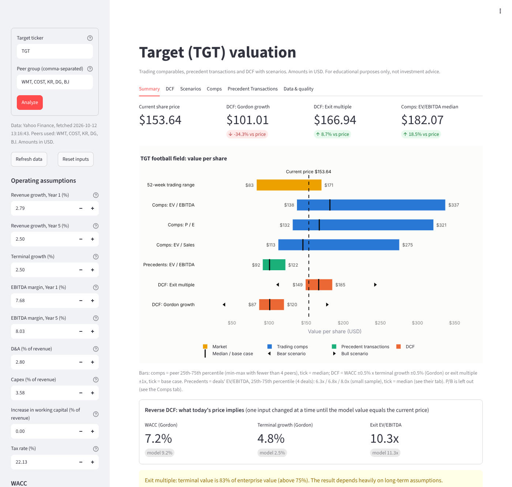

# US Retail Valuation: Comparable Companies + DCF

A valuation tool for **Target (TGT)**, benchmarked against **Walmart (WMT), Costco (COST),
Kroger (KR), Dollar General (DG) and BJ's Wholesale Club (BJ)**.
It combines a trading-comparables analysis with a discounted cash flow (DCF) model and
summarises both in a "football field" chart, the way an investment banking pitch book would.

> Built as a learning project by an IB Diploma student interested in economics, finance and
> investment banking.


*(screenshot to be added)*

## Status

| Stage | Content | Status |
|---|---|---|
| 1 | Data layer: download, cache, manual overrides, data quality report | Done |
| 2 | Comparable companies (multiples, peer statistics, implied value) | Done |
| 3 | DCF (FCFF projection, WACC, Gordon growth + exit multiple, sensitivity) | Done |
| 4 | Streamlit app, football field chart, Excel export | Planned |

## Methodology

### Data (Stage 1)
- Source: Yahoo Finance via `yfinance`. All figures are in **USD**.
- **TTM (trailing twelve months)** revenue, EBITDA and net income are rebuilt by summing the
  last four quarterly reports, not taken from Yahoo's summary fields. Yahoo's ready-made
  number is kept as a cross-check, and differences above 10% are shown in the data quality report.
- **Enterprise value** is calculated as market cap + debt − cash, so every step of the
  bridge is visible. Yahoo's own EV is used only as a cross-check.
- **Leases are excluded from debt** (switch: `EXCLUDE_LEASES_FROM_DEBT` in `config.py`).
  Under US GAAP (ASC 842) store rent is an operating expense, so EBITDA is already after rent;
  counting lease liabilities as debt as well would count rent twice. Yahoo does not separate
  finance from operating leases, so small finance leases are excluded too.
- **Risk-free rate**: the 10-year US Treasury yield (`^TNX`), downloaded live. The country
  risk premium defaults to 0 for the US.
- **Manual overrides**: any value can be replaced in `data/manual_overrides.csv`
  (with a source note). Every value is tagged as `auto`, `manual`, `derived` or `missing`.
  TTM values adjusted for a one-off record the quarter that contains the one-off and the
  TTM window they were calculated for; the data quality report flags the override as stale
  once that quarter leaves the window or a newer quarter is reported.
- **No invented data**: if a value cannot be found it stays `N/A` and is flagged. It is never estimated.

### Comparable companies (Stage 2)
- Multiples: **EV/Sales, EV/EBITDA, P/E, P/B**, plus EBITDA margin and net margin (all TTM).
- Peer statistics (mean, median, min, max, 25th/75th percentile) use the **peers only**;
  the target is never included in its own benchmark.
- **Exclusions**: a multiple is dropped (shown as "NM", not meaningful) if an input is missing,
  the denominator is zero or negative (e.g. P/E of a loss-making company), or it exceeds a
  sanity cap set in `config.py` (e.g. P/E > 100x). Every exclusion is listed with its reason.
- **Valuation range**: the 25th-75th percentile of peer multiples (min-max if fewer than
  4 valid peers), with the median as the mid-point.
- **Bridge to value per share**:
  - EV multiples: target metric × multiple = implied EV → − net debt = equity value → ÷ shares = value per share
  - Equity multiples (P/E, P/B): target metric × multiple = equity value → ÷ shares (no net debt step)
- Peer selection matters: Walmart and Costco trade at premium multiples, which pulls the peer
  median up. The range is a starting point for judgement, not an answer.

### DCF (Stage 3)
- **5-year projection** starting from TTM revenue (Year 1 = the next twelve months).
  Default assumptions (all editable, each shown next to the history it comes from):
  - D&A, capex (% of revenue) and tax rate: **average of the last 3 fiscal years**
    (`DEFAULT_HISTORY_YEARS`). The all-years average and the latest year are shown for comparison.
  - EBITDA margin: Year 1 = **current TTM margin with one-offs removed**, moving in a
    **straight line to the last 3 years' average** in Year 5. Start and end margin are
    edited separately in the app.
  - Increase in net working capital: **0% of revenue** (`DEFAULT_NWC_PCT`), because the history
    swings by 2-3% of revenue with a single inventory build.
  - Revenue growth: Year 1 = TTM revenue vs the last full fiscal year (growth already visible
    in the reported quarters), then a **straight line to the terminal growth rate** in Year 5.
    Falls back to the historical CAGR if TTM revenue is missing.
- **FCFF** = EBIT × (1 − tax) + D&A − capex − increase in net working capital.
- **WACC** = E/(D+E) × cost of equity + D/(D+E) × after-tax cost of debt, with market-value weights.
  - Cost of equity (CAPM) = risk-free rate (10y Treasury, live) + beta (Yahoo) × equity risk
    premium (assumption: 5.0%) + country risk premium (0 for the US).
  - Pre-tax cost of debt = risk-free rate + credit spread (assumption: 1.25%). The historical
    interest expense / debt ratio is shown for reference but not used, because it reflects
    bonds issued when rates were lower.
- **Terminal value**, two methods side by side:
  - Gordon growth: FCFF(N) × (1 + g) / (WACC − g), default g = 2.5%
  - Exit multiple: EBITDA(N) × peer median EV/EBITDA from the comps
  - Each is cross-checked against the other (implied exit multiple / implied growth rate).
- **Mid-year convention** (default on): cash flows are discounted at t − 0.5. Following
  Rosenbaum & Pearl, the Gordon terminal value is discounted at N − 0.5, the exit multiple
  terminal value at N (it is a sale price at the end of year N).
- **Bridge**: EV − net debt = equity value ÷ shares = value per share, vs current price.
- **Reverse DCF**: the WACC, terminal growth and exit multiple at which the model value equals
  today's share price.
- **Sensitivity tables**: WACC ±2% (0.5% steps) × terminal growth ±1% (0.5% steps), and
  WACC × exit multiple ±2x (1x steps), shown as heatmaps colored around the current price.
- A warning is shown when the terminal value is more than 75% of enterprise value.

### Data quality checks
Missing fields, zero or negative EBITDA, losses (P/E excluded), negative equity, price outside
the 52-week range, price × shares vs market cap, our EV vs Yahoo's EV, reporting currency,
and stale annual statements.

## Valuation commentary
*Figures as of 9 October 2026 (price $153.64, 10-year Treasury 5.24%); they move with the data.*

### One-off items (manual overrides)
Two one-offs distort the trailing twelve months, and neither is removed by Yahoo's
"normalized" figures:
- **Kroger**: a $2,585m impairment and related charges for its automated fulfillment network
  (Q3 FY2025, quarter ending Nov 2025). It is non-cash and inside operating expenses, so the
  sum of four quarters gives TTM EBITDA of only $5.8bn and P/E of 34x. Added back: EBITDA
  $8.4bn (EV/EBITDA 6.0x), net income $3.0bn (P/E 12.0x). This lowers the peer median P/E
  from 33.8x to 20.9x; the median EV/EBITDA (11.3x) does not change.
- **Target**: $994m of IEEPA tariff refunds booked as lower cost of sales in Q2 2026. Removed:
  TTM EBITDA $8.27bn instead of $9.26bn (margin 7.7% instead of 8.6%), net income $3.64bn.

Both are in `data/manual_overrides.csv` with the SEC source and will be flagged as stale when
the TTM window moves (Kroger's charge drops out once Q3 FY2026 is reported).

### Why the default assumptions changed
The first version averaged all four years Yahoo provides. The oldest year (fiscal year ending
January 2023) was Target's inventory glut year: 6.0% EBITDA margin, 5.1% capex and a 2.2%
working capital build. Averaged in, it produced a model that was internally inconsistent:
revenue shrinking 1.3% a year forever while capex stayed above D&A and the company kept
investing in working capital, and then a Gordon terminal value growing that depressed cash
flow at 2.5% forever. Projected FCFF was about $2.2bn a year, against an actual free cash
flow (operating cash flow - capex) of $3.7bn a year over the last three years.
The defaults now use the last three years for D&A, capex (3.6%) and tax, 0% working capital and
a growth path that starts from the growth already visible in 2026 (+2.8%) and fades to 2.5%.

The EBITDA margin starts from where Target is today and moves to where it has been: Year 1 uses
the current TTM margin with the tariff refund removed (7.7%), rising in a straight line to the
last three years' average (8.0%) in Year 5. Starting at 8.0% straight away would assume the
recovery has already happened; staying at 7.7% would ignore that 2023-2025 margins were
steadily around 8%. Guidance supports a gradual path: in its Q2 2026 results Target guided its underlying 2026
operating margin (excluding the refunds) to about 0.5 points above 2025's adjusted 4.6%, not a jump back to earlier levels.
Effect on the Gordon value per share: $47 -> $101.

### Why the Gordon and exit multiple results differ
- **Gordon growth: $101 (-34%)**. With WACC 9.2% and g 2.5%, the terminal value equals
  6.3x final-year EBITDA.
- **Exit multiple: $167 (+9%)**. The peer median EV/EBITDA of 11.3x implies a perpetual
  growth rate of 5.4%, which no mature retailer can sustain forever.

The two methods ask different questions. Gordon asks what the cash flows are worth at
*our* discount rate; the exit multiple asks what buyers pay *today* for similar companies.
The peer median is pulled up by Walmart (19.8x) and Costco (28.1x), which trade at premium
multiples for their growth and membership models; Target itself trades at 9.7x. The truth
probably sits in between, and the gap is shown rather than hidden.

### What the current price implies (reverse DCF)
With every other assumption unchanged, today's price of $153.64 implies:
- a **WACC of 7.2%** (the model uses 9.2%), or
- a **terminal growth rate of 4.9%** at the model WACC, or
- an **exit multiple of 10.3x**.

The WACC is high because the risk-free rate is high (5.24%): cost of equity = 5.24% + 0.98 x 5.0%
= 10.1%. We do not lower it to "fit" the price; the live rate is market data, and the
sensitivity tables show how the value moves with WACC. The honest reading is that, at
today's interest rates, the market price needs either a lower required return or more
growth/margin recovery than Target's recent history shows.

### Why leases are excluded from enterprise value (ASC 842)
Under US GAAP (ASC 842) operating lease costs (store rent) stay in operating expenses, so
EBITDA is already *after* rent. Lease liabilities are on the balance sheet and Yahoo includes
them in total debt. If we put them in EV but use post-rent EBITDA, rent is counted twice:
once as a cost that lowers EBITDA and once as debt that raises EV. EV/EBITDA would then be
overstated, and more so for companies that lease more stores (Dollar General's lease
liabilities are $11.2bn against $4.6bn of financial debt). So EV = market cap + financial debt
- cash, consistently for the target and every peer. The alternative (EV including leases with
EBITDAR, i.e. before rent) is also consistent, but Yahoo does not report rent for every company.

## Assumptions and limitations
- **Data quality**: Yahoo Finance is free and convenient but not audited. Key numbers should
  be checked against the companies' 10-K / 10-Q filings (SEC EDGAR).
- **Fiscal years differ**: Target, Walmart, Kroger, Dollar General and BJ's close their year in
  late January / early February, while Costco closes at the end of August. Annual data is
  therefore labelled by the fiscal year **end date**. Note that Target calls the year ending
  January 2026 "fiscal 2025".
- **Leases**: Yahoo's "total debt" includes lease liabilities. Retailers lease many stores, so
  this matters for net debt and EV. EBITDA should be read consistently with that choice.
- **TTM from quarters**: summing four quarters assumes no later restatements. Costco's
  quarters have unequal lengths (12/12/12/16 weeks), but four consecutive quarters still cover a full year.
- Yahoo usually provides only 4 years of annual statements, so the default DCF assumptions
  rest on 3-4 data points. One unusual year (e.g. a big working capital build) moves the average.
- Apart from revenue growth and the EBITDA margin (which move in a straight line), the DCF uses the same assumption
  for all 5 years by default. Per-year inputs are supported.
- Manual overrides are fixed numbers. They are checked for staleness but must be updated by hand.
- The equity risk premium, credit spread and terminal growth are judgement calls, not data.

## Project structure
```
config.py              tickers, settings and thresholds
data_loader.py         download, cache, overrides, data quality report
comps.py               trading multiples, peer statistics, implied value bridge
dcf.py                 projection, FCFF, WACC, terminal value, sensitivity tables
charts.py              Plotly charts (sensitivity heatmap)
data/manual_overrides.csv
data/cache/            downloaded data (not in git)
tests/                 pytest unit tests (offline, small hand-checkable numbers)
```

## How to run
```bash
python3 -m venv .venv
source .venv/bin/activate
pip install -r requirements.txt

python data_loader.py            # snapshot, annual history and data quality report
python data_loader.py --refresh  # ignore the 24h cache and download again
python comps.py                  # comparable companies analysis
python dcf.py                    # DCF valuation in the terminal
python dcf.py --html             # also save sensitivity heatmaps to output/
pytest                           # run the unit tests
```

If you download SEC filings with your own scripts, set your contact in an environment
variable rather than in the code (the SEC rejects requests without one):
`export SEC_USER_AGENT="Your Name you@example.com"` (read as `config.SEC_USER_AGENT`).

## Changing the companies
Edit `TARGET`, `PEERS` and `COMPANY_NAMES` in `config.py`.

*Disclaimer: for educational purposes only, not investment advice.*
